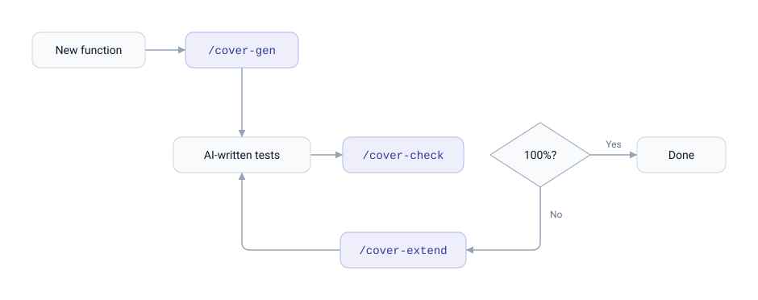

# coverwise-mcp

[](https://github.com/libraz/coverwise-mcp/actions)
[](LICENSE)
[](https://nodejs.org/)
[](https://yarnpkg.com/)
[](https://biomejs.dev/)
[](https://modelcontextprotocol.io/)
[](https://docs.claude.com/en/docs/claude-code)
[](https://github.com/libraz/coverwise)

Pairwise / t-wise combinatorial coverage for AI-written tests, delivered as a Claude Code plugin.

When Claude writes tests for code that takes multiple parameters — CLI flags, config options, feature flags, query params, form fields, state machines — it often picks a handful of "reasonable" cases and misses interactions. `coverwise-mcp` gives Claude the tools and the knowledge to do this properly: build a parameter model, detect uncovered interactions, and generate or extend the minimum test matrix that exercises every combination that matters.

Under the hood it wraps [**coverwise**](https://github.com/libraz/coverwise), a WASM-first combinatorial test engine, as an MCP server.

## What's in the box

- **MCP server** exposing the coverwise engine (`pairwise_generate`, `pairwise_analyze`, `pairwise_extend`, `pairwise_estimate`)
- **Skill** that teaches Claude the constraint DSL, common recipes, and the anti-patterns to avoid
- **Slash commands** for the three everyday operations:
  - `/cover-check` — analyze the current test file's combinatorial coverage and list gaps
  - `/cover-gen` — build a fresh minimum test matrix for a function or endpoint
  - `/cover-extend` — append the minimum new tests to reach full coverage, leaving existing tests alone
- **Session hook** that states the applicability rule up front in code checkouts, so a plain "write tests for this" reaches for the tools instead of picking combinations by eye

## The loop

<picture>
  <source media="(prefers-color-scheme: dark)" srcset="assets/loop-dark.svg">
  
</picture>

Most combinatorial tools only support generation. coverwise — and therefore this plugin — treats *analyze* and *extend* as first-class operations, which matches how people (and AIs) actually write tests: iteratively, on top of what's already there.

## Install

```
/plugin marketplace add libraz/coverwise-mcp
/plugin install coverwise-mcp
```

That's it. On the first Claude Code session after installation, a `SessionStart` hook installs the MCP server's runtime dependencies into `${CLAUDE_PLUGIN_DATA}` — a location that survives plugin updates. The install is idempotent and silent on subsequent sessions.

A second `SessionStart` hook adds a short note to the session context: the four tool names and the rule for when they apply. It only runs where the working directory looks like a code project (`package.json`, `go.mod`, `pyproject.toml`, `Cargo.toml`, `pom.xml`, …) and stays silent everywhere else.

Requirements:

- **Node ≥ 22** and **npm** on your `PATH` (npm ships with Node; no separate install needed).

### For contributors / local development

Clone the repo and install dev dependencies with Yarn 4 (pinned via mise):

```bash
git clone https://github.com/libraz/coverwise-mcp
cd coverwise-mcp
yarn install
```

The pinned toolchain (Node 22.23.2, Yarn 4.18.0) is declared in `mise.toml`. Run `mise install` and [mise](https://mise.jdx.dev/) applies it on entering the directory.

## How it gets invoked

Installing the plugin does **not** mean Claude will reach for it on every test. It engages when combinatorial coverage actually matters and stays out of the way otherwise. Three mechanisms, in increasing order of explicitness:

**1. Session context** — in a code checkout, the `SessionStart` hook states the rule before any request arrives: writing, reviewing or extending tests for something with **≥ 3 independent parameters** means building a parameter model and using the tools. This is what covers the common case — a plain "write tests for this" that mentions nothing about coverage or combinations, which the skill description alone would never match.

**2. Skill match** — the bundled skill's description matches when a request already sounds combinatorial: you mention "pairwise", "t-wise", "covering array", "combinatorial" or "test matrix", or the parameter space is obviously too large for a hand-written cartesian product.

Neither fires for tests with only 1–2 parameters, which is correct — pairwise would be overkill. Auditing a suite Claude is not currently working on is also not something it does unprompted; that's what `/cover-check` is for.

**3. Slash commands** — always available:

| Command | When to use |
|---|---|
| `/cover-check [path]` | Ask Claude to audit an existing test file's combinatorial coverage |
| `/cover-gen [target]` | Build a fresh minimum test matrix for a function / endpoint |
| `/cover-extend [path]` | Append the minimum new tests to reach full coverage without touching existing ones |

### Reinforce it for a project

The session hook already states the rule, but a project can restate it in its own `CLAUDE.md` — useful when the repo has a house style for test tables, or when the rule should apply at a lower parameter count:

```markdown
## Testing

When writing tests for functions or components with ≥ 3 input parameters,
use the coverwise MCP tools (pairwise_analyze / pairwise_generate /
pairwise_extend) to verify combinatorial coverage before finishing. Prefer
/cover-check for auditing existing tests and /cover-extend for filling gaps.
See the coverwise skill for the constraint DSL.
```

## Example

> *"Write tests for `render(theme, density, locale, dir)` where theme ∈ {light, dark, hc}, density ∈ {compact, cozy}, locale ∈ {en, ja, ar}, dir ∈ {ltr, rtl}. Arabic must be RTL; everything else LTR."*

Claude calls `pairwise_generate` with the parameter model as a plain map:

```json
{
  "model": {
    "theme":   ["light", "dark", "hc"],
    "density": ["compact", "cozy"],
    "locale":  ["en", "ja", "ar"],
    "dir":     ["ltr", "rtl"]
  },
  "constraints": [
    "IF locale = ar THEN dir = rtl",
    "IF locale IN {en, ja} THEN dir = ltr"
  ]
}
```

and gets back a table:

```json
{
  "columns": ["theme", "density", "locale", "dir"],
  "rows": [
    ["hc",    "compact", "ar", "rtl"],
    ["light", "cozy",    "ar", "rtl"],
    ["hc",    "cozy",    "ja", "ltr"],
    ["dark",  "compact", "ar", "rtl"],
    ["…",     "…",       "…",  "…"]
  ],
  "coverage": 1,
  "strength": 2,
  "stats": { "totalTuples": 34, "coveredTuples": 34, "testCount": 10 }
}
```

10 tests covering every valid 2-way interaction — against 18 combinations the constraints allow, out of a 36-case raw cartesian product. `rows` is positional and in `columns` order, so it drops straight into `test.each` / `t.Run` tables / `pytest.mark.parametrize`. The constraint DSL supports `IF/THEN/ELSE`, `AND/OR/NOT`, relational operators, `IN`, and `LIKE` — see the bundled skill for the full grammar and recipes.

## MCP tools

| Tool | Purpose |
|---|---|
| `pairwise_generate` | Build a minimal t-wise test suite from a parameter model + constraints |
| `pairwise_analyze` | Report the parameter interactions an existing suite never exercises |
| `pairwise_extend` | Add the minimum extra tests to reach 100%, preserving existing ones |
| `pairwise_estimate` | Pre-flight sizing (parameters, tuples, estimated tests) without generating |

The model can be given as the `model` map above or as an explicit `parameters` array; test cases are accepted both as `{ param: value }` maps and as positional rows, so the `rows` from one call can be passed straight back into the next. Values come back in the JSON type they were declared with.

All tools return structured JSON and report coverage in one shape — `coverage`, `stats`, and uncovered tuples as display strings such as `"os=linux, browser=safari"`; constraint-unreachable tuples are removed from the coverage universe. Coverage reports include the authoritative `uncoveredCount`, `omittedUncovered` when the 1,000-entry diagnostic list is truncated, and `invalidTests` for existing rows excluded from coverage accounting. `pairwise_extend` additionally returns `newRows` — just the additions, ready to append to the file — and `before`, the coverage of the suite as it stood, so no separate analyze call is needed to explain them. Values marked `invalid` are kept out of the positive suite and returned as single-fault `negativeRows`, with `negativeCoverage` metrics alongside; models using equivalence classes also get `classCoverage`.

## Using outside Claude Code

The MCP server is a plain stdio server and works with any MCP client. Inside Claude Code, use the plugin marketplace above; everywhere else, the install helper wires the server into your client's config for you.

### Install helper (recommended)

Run the interactive helper — it writes a `coverwise` MCP entry into the config files you select, preserving every other server and key:

```bash
npx -y github:libraz/coverwise-mcp init
```

Pick one or more targets (comma-separated, e.g. `1,3`):

| | Client | Config file |
|---|---|---|
| 1 | Claude Code | `~/.claude.json` |
| 2 | Claude Code (project) | `./.mcp.json` |
| 3 | Codex CLI | `~/.codex/config.toml` |
| 4 | Claude Desktop | `~/Library/Application Support/Claude/claude_desktop_config.json` |
| 5 | Cursor | `~/.cursor/mcp.json` |
| 6 | Cline (VS Code) | `…/globalStorage/saoudrizwan.claude-dev/settings/cline_mcp_settings.json` |
| 7 | Gemini CLI | `~/.gemini/settings.json` |

Paths outside the home directory root follow the platform convention (`%APPDATA%` on Windows, `$XDG_CONFIG_HOME` on Linux).

It prints exactly which files it will touch (`(new)` / `(merge)` / `(replace coverwise)`) and asks for confirmation before writing. Each file is rewritten through a temp file and an atomic rename, keeping its current permissions, so a config a running client is reading can never be left half-written. To remove the entry again:

```bash
npx -y github:libraz/coverwise-mcp uninstall
```

The generated entry runs the server via `npx -y github:libraz/coverwise-mcp`, so there is nothing to clone or build — npm fetches it on first launch. Restart your MCP client afterwards to pick up the change.

### Manual config

Prefer to wire it up yourself? Point your client at the bundled launcher:

```json
{
  "mcpServers": {
    "coverwise": {
      "command": "npx",
      "args": ["-y", "github:libraz/coverwise-mcp"]
    }
  }
}
```

Or, if you've cloned the repo locally, run `mcp/server.mjs` directly after installing runtime dependencies (`npm install --omit=dev` or `yarn install`) in the project root:

```json
{
  "mcpServers": {
    "coverwise": {
      "command": "node",
      "args": ["/absolute/path/to/coverwise-mcp/mcp/server.mjs"]
    }
  }
}
```

## About coverwise

The engine underneath is [**coverwise**](https://github.com/libraz/coverwise) v1.5 — a WASM-first C++17 combinatorial test engine with a pure TypeScript fallback, supporting arbitrary t-wise strength, a full constraint solver, validated generation options, negative tests, mixed-strength sub-models, boundary values, and equivalence classes. This plugin is a thin shell that exposes its JS API to Claude Code.

## License

[Apache License 2.0](LICENSE)
