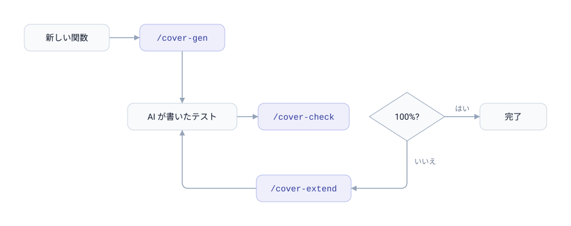

# coverwise-mcp

[](https://github.com/libraz/coverwise-mcp/actions)
[](LICENSE)
[](https://nodejs.org/)
[](https://yarnpkg.com/)
[](https://biomejs.dev/)
[](https://modelcontextprotocol.io/)
[](https://docs.claude.com/en/docs/claude-code)
[](https://github.com/libraz/coverwise)

AI が書くテストのための pairwise / t-wise 組合せカバレッジを、Claude Code プラグインとして提供します。

Claude が複数パラメータを持つコード — CLI フラグ、設定オプション、フィーチャーフラグ、クエリパラメータ、フォーム項目、状態遷移 — のテストを書くとき、しばしば「それっぽい」ケースをいくつか選んで相互作用を取りこぼします。`coverwise-mcp` は、パラメータモデルを作り、未カバーの組合せを検出し、必要な最小のテスト行列を生成 / 追加するための**ツールと知識**を Claude に渡します。

裏側で動いているのは [**coverwise**](https://github.com/libraz/coverwise) — WASM ファーストの組合せテストエンジンで、本プラグインはこれを MCP サーバーとして公開する薄いラッパーです。

## 同梱物

- **MCP サーバー** — coverwise エンジンを 4 ツール(`pairwise_generate` / `pairwise_analyze` / `pairwise_extend` / `pairwise_estimate`)として公開
- **Skill** — 制約 DSL の文法、定番レシピ、避けるべきアンチパターンを Claude に教える
- **スラッシュコマンド** — 日常的な 3 操作:
  - `/cover-check` — 現在のテストファイルの組合せカバレッジを解析し、不足を列挙
  - `/cover-gen` — 関数 / エンドポイントに対する最小テスト行列を新規生成
  - `/cover-extend` — 既存テストは触らず、100% に到達するための最小テストだけ追加
- **セッションフック** — コードリポジトリでは適用ルールを冒頭で提示するため、単なる「テストを書いて」でも組合せを目視で選ばずツールに載る

## ワークフロー

<picture>
  <source media="(prefers-color-scheme: dark)" srcset="assets/loop-ja-dark.svg">
  
</picture>

多くの組合せテストツールは「生成」だけをサポートしますが、coverwise — したがって本プラグイン — は**解析**と**追加**を第一級の操作として扱います。これは人間(そして AI)が実際にテストを書いていく流れ — 既存の上に反復的に積み上げる — と噛み合っています。

## インストール

```
/plugin marketplace add libraz/coverwise-mcp
/plugin install coverwise-mcp
```

以上です。インストール後の最初の Claude Code セッションで `SessionStart` フックが動き、MCP サーバーの実行時依存を `${CLAUDE_PLUGIN_DATA}`(プラグイン更新後も保持される領域)にインストールします。べき等なので、2 回目以降は静かにスキップされます。

もう 1 つの `SessionStart` フックが、4 つのツール名と適用ルールを短い文でセッションコンテキストに追加します。作業ディレクトリがコードプロジェクトに見える場合(`package.json`、`go.mod`、`pyproject.toml`、`Cargo.toml`、`pom.xml` など)にだけ動き、それ以外では何も出しません。

要件:

- **Node 22 以上** と **npm** が `PATH` にあること(npm は Node 同梱なので別途インストール不要)

### コントリビューター / ローカル開発向け

リポジトリをクローンして Yarn 4(mise で固定)で開発依存を入れます:

```bash
git clone https://github.com/libraz/coverwise-mcp
cd coverwise-mcp
yarn install
```

ツールチェーン(Node 22.23.2、Yarn 4.18.0)は `mise.toml` に固定されています。[mise](https://mise.jdx.dev/) を入れて `mise install` すればディレクトリに入った時点で適用されます。

## どうやって発動するか

プラグインを入れただけで Claude がすべてのテストで勝手に使ってくれるわけでは**ありません**。些細なケースでは邪魔にならず、組合せカバレッジが実際に問題になる場面でだけ動きます。発動経路は 3 つあり、明示度の低い順に:

**1. セッションコンテキスト** — コードリポジトリでは `SessionStart` フックが、依頼が来る前にルールを提示します。**3 つ以上の独立したパラメータ**(フラグ、enum、モード、設定項目、クエリパラメータ、フォーム項目、状態遷移入力)を持つ対象のテストを書く / 見直す / 追加するなら、パラメータモデルを作ってツールを使う、というものです。カバレッジにも組合せにも触れない単なる「テストを書いて」— Skill の description だけでは決してマッチしない最頻ケース — をここで拾います。

**2. Skill のマッチ** — 依頼の時点で組合せの話に見える場合に同梱 Skill が反応します。「pairwise」「t-wise」「covering array」「組合せテスト」「テスト行列」といった語が出たとき、あるいはパラメータ空間が明らかに大きく手書きの直積では非現実的なときです。

パラメータが 1〜2 個しかない小さなテストではどちらも発動しません(これは正しい挙動で、過剰適用を避けています)。今まさに触っているわけではないテスト集合の監査も自発的には行いません。そのための `/cover-check` です。

**3. スラッシュコマンド** — いつでも使えます:

| コマンド | 使いどころ |
|---|---|
| `/cover-check [path]` | 既存テストファイルの組合せカバレッジを監査させる |
| `/cover-gen [target]` | 関数 / エンドポイントに対する最小テスト行列を新規生成 |
| `/cover-extend [path]` | 既存テストを触らず、100% 到達のための最小テストだけ追加 |

### プロジェクト側で補強する

ルール自体はセッションフックが提示しますが、プロジェクトの `CLAUDE.md` で改めて書いておくこともできます。テストテーブルの書き方にリポジトリ固有の流儀がある場合や、もっと少ないパラメータ数から適用したい場合に有効です:

```markdown
## テスト

3 つ以上の入力パラメータを持つ関数 / コンポーネントのテストを書くときは、
仕上げる前に coverwise MCP ツール(pairwise_analyze / pairwise_generate /
pairwise_extend)を使って組合せカバレッジを確認すること。既存テストの監査には
/cover-check を、不足の追加には /cover-extend を優先する。制約 DSL の詳細は
同梱 Skill を参照。
```

## 使用例

> *「`render(theme, density, locale, dir)` のテストを書いて。theme ∈ {light, dark, hc}、density ∈ {compact, cozy}、locale ∈ {en, ja, ar}、dir ∈ {ltr, rtl}。アラビア語は RTL、それ以外は LTR。」*

Claude は `pairwise_generate` を、パラメータモデルを素のマップにして呼び出します:

```json
{
  "model": {
    "theme":   ["light", "dark", "hc"],
    "density": ["compact", "cozy"],
    "locale":  ["en", "ja", "ar"],
    "dir":     ["ltr", "rtl"]
  },
  "constraints": [
    "IF locale = ar THEN dir = rtl",
    "IF locale IN {en, ja} THEN dir = ltr"
  ]
}
```

返ってくるのは表です:

```json
{
  "columns": ["theme", "density", "locale", "dir"],
  "rows": [
    ["hc",    "compact", "ar", "rtl"],
    ["light", "cozy",    "ar", "rtl"],
    ["hc",    "cozy",    "ja", "ltr"],
    ["dark",  "compact", "ar", "rtl"],
    ["…",     "…",       "…",  "…"]
  ],
  "coverage": 1,
  "strength": 2,
  "stats": { "totalTuples": 34, "coveredTuples": 34, "testCount": 10 }
}
```

有効な 2-way 相互作用をすべてカバーして 10 ケース。制約を課す前の直積は 36 通り、制約を満たす組合せは 18 通りです。`rows` は `columns` の順に並んだ位置配列なので、`test.each` / `t.Run` のテーブル / `pytest.mark.parametrize` にそのまま流し込めます。制約 DSL は `IF/THEN/ELSE`、`AND/OR/NOT`、関係演算子、`IN`、`LIKE` をサポートしています。完全な文法とレシピは同梱 Skill を参照してください。

## MCP ツール

| ツール | 役割 |
|---|---|
| `pairwise_generate` | パラメータモデル + 制約から最小の t-wise テスト集合を生成 |
| `pairwise_analyze` | 既存テスト集合が一度も踏んでいない組合せを報告 |
| `pairwise_extend` | 既存を保持したまま、100% 到達のための最小テストを追加 |
| `pairwise_estimate` | 生成せずに規模を事前確認(パラメータ数、tuple 数、想定テスト数) |

モデルは上記の `model` マップでも、明示的な `parameters` 配列でも渡せます。テストケースは `{ パラメータ名: 値 }` のマップと位置配列の両方を受け付けるため、あるツールが返した `rows` をそのまま次のツールに渡せます。値は宣言時の JSON 型のまま返ります。

すべてのツールは構造化 JSON を返し、カバレッジを共通の形（`coverage`、`stats`、`"os=linux, browser=safari"` のような表示文字列で並ぶ未カバー tuple）で報告します。制約上到達不能な tuple はカバレッジ母集団から除外されます。カバレッジレポートには未カバー総数 `uncoveredCount`、診断リストが 1,000 件で打ち切られた場合の `omittedUncovered`、カバレッジ計算から除外された既存行を示す `invalidTests` が含まれます。`pairwise_extend` はさらに、追加分だけを取り出してそのままファイル末尾に足せる `newRows` と、追加前のカバレッジ `before` を返すので、追加理由の説明に別途 analyze を呼ぶ必要はありません。`invalid` を付けた値は正常系スイートから除外され、単一障害の `negativeRows` として `negativeCoverage` の指標とともに返されます。同値クラスを使ったモデルでは `classCoverage` も付きます。

## Claude Code 以外での利用

MCP サーバーは素の stdio サーバーで、任意の MCP クライアントから利用できます。Claude Code 内では上記のプラグインマーケットプレイスを使い、それ以外ではインストールヘルパーが各クライアントの設定への登録を代行します。

### インストールヘルパー(推奨)

対話式ヘルパーを実行すると、選択した設定ファイルに `coverwise` の MCP エントリを書き込みます。他のサーバーやキーはそのまま保持されます:

```bash
npx -y github:libraz/coverwise-mcp init
```

書き込み先はカンマ区切りで複数選択できます(例 `1,3`):

| | クライアント | 設定ファイル |
|---|---|---|
| 1 | Claude Code | `~/.claude.json` |
| 2 | Claude Code(プロジェクト) | `./.mcp.json` |
| 3 | Codex CLI | `~/.codex/config.toml` |
| 4 | Claude Desktop | `~/Library/Application Support/Claude/claude_desktop_config.json` |
| 5 | Cursor | `~/.cursor/mcp.json` |
| 6 | Cline(VS Code) | `…/globalStorage/saoudrizwan.claude-dev/settings/cline_mcp_settings.json` |
| 7 | Gemini CLI | `~/.gemini/settings.json` |

ホーム直下以外のパスはプラットフォームの慣習に従います(Windows は `%APPDATA%`、Linux は `$XDG_CONFIG_HOME`)。

どのファイルをどう変更するか(`(new)` / `(merge)` / `(replace coverwise)`)を表示し、書き込み前に確認を求めます。書き込みは一時ファイル + アトミックな rename で行い、既存のパーミッションを引き継ぐため、クライアントが読み込み中の設定ファイルが壊れることはありません。削除する場合:

```bash
npx -y github:libraz/coverwise-mcp uninstall
```

生成されるエントリは `npx -y github:libraz/coverwise-mcp` でサーバーを起動するため、クローンやビルドは不要です(初回起動時に npm が取得します)。反映には MCP クライアントの再起動が必要です。

### 手動設定

自分で登録したい場合は、同梱のランチャーを指定します:

```json
{
  "mcpServers": {
    "coverwise": {
      "command": "npx",
      "args": ["-y", "github:libraz/coverwise-mcp"]
    }
  }
}
```

リポジトリをローカルにクローン済みなら、プロジェクトルートで実行時依存(`npm install --omit=dev` または `yarn install`)をインストールした上で `mcp/server.mjs` を直接指定することもできます:

```json
{
  "mcpServers": {
    "coverwise": {
      "command": "node",
      "args": ["/absolute/path/to/coverwise-mcp/mcp/server.mjs"]
    }
  }
}
```

## coverwise について

裏側のエンジンは [**coverwise**](https://github.com/libraz/coverwise) v1.5 — WASM ファーストの C++17 組合せテストエンジン(Pure TypeScript フォールバックあり)で、任意の t-wise 強度、完全な制約ソルバー、生成オプション検証、ネガティブテスト、混合強度サブモデル、境界値、同値クラスをサポートします。本プラグインはその JS API を Claude Code に公開する薄い殻です。

## ライセンス

[Apache License 2.0](LICENSE)
